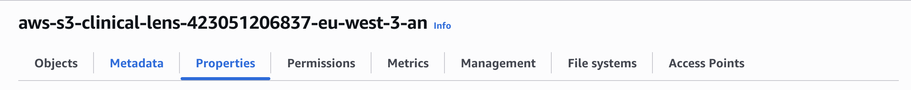
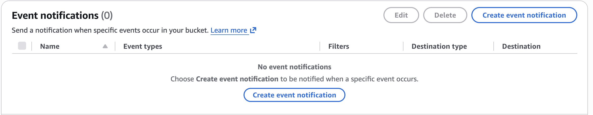

# Data ingestion pipeline
## Description
The data ingestion pipeline is orchestrated on AWS. The documents are stored in S3, and each event (created, deleted) sends a message to SQS, which is processed by a Lambda function. This choice was made for the following reasons:
- Ability to scale: with the combination of SQS and Lambda, we can achieve good scaling when there is a large number of documents
in S3, with control from SQS to prevent rate limiting of external services (embedding, vectorDB).
- We use external services for embedding and vectorDB: the CPU consumption is low and there is no GPU usage, which is suitable for a Lambda function.

Downsides:
- Monitoring effort: even though there are built-in functionalities (X-Ray, CloudWatch, etc.) for monitoring, we need to put some effort into pulling them into
our centralized Grafana dashboard.

## Prerequisites
User role: the user must have the needed permissions in their policy, such as: push to ECR, create/update a Lambda function, and pass a role to a Lambda function.
### SQS
Go to the [Amazon SQS console](https://console.aws.amazon.com/sqs). The `Visibility timeout` should be longer than the `Lambda` timeout. Leave every option at default and create the queue.
The only option we are concerned with is the Dead-letter queue, which receives messages that repeatedly fail processing.
For the policy, we need to add a statement that allows S3 to send messages to the queue. Follow these 2 steps:
1. Modify the policy at creation and add this statement:
```json
{
    "Sid": "AllowS3SendMessage",
    "Effect": "Allow",
    "Principal": {
        "Service": "s3.amazonaws.com"
        },
        "Action": "sqs:SendMessage",
        "Resource": "arn:aws:sqs:<REGION>:<ACCOUNT>:<SQS_NAME>",
        "Condition": {
        "StringEquals": {
            "aws:SourceAccount": "<ACCOUNT>"
        },
        "ArnLike": {
            "aws:SourceArn": "<S3_ARN>"
        }
    }
}
```
2. Configure the notification in the S3 console.
Access the `Properties` tab.

Create an event notification in the Event notifications section.

- Set `suffix` to `.pdf`
- Choose `All object create events` and `All object removal events`
- In `Destination`, choose `SQS queue` and pick the created SQS queue


### Lambda role:
- Able to read items from SQS (AWSLambdaSQSQueueExecutionRole)
- Able to read S3 objects and read parameters from Systems Manager (or from Secrets Manager if used - more expensive!!)

The policy for the role:
```json
{
	"Version": "2012-10-17",
	"Statement": [
		{
			"Sid": "ReadSqsQueue",
			"Effect": "Allow",
			"Action": [
				"sqs:ReceiveMessage",
				"sqs:DeleteMessage",
				"sqs:GetQueueAttributes"
			],
			"Resource": "<ARN_SQS_QUEUE>"
		},
		{
			"Sid": "CreateLogGroup",
			"Effect": "Allow",
			"Action": "logs:CreateLogGroup",
			"Resource": "arn:aws:logs:<REGION>:<ACCOUNT>:log-group:/aws/lambda/clinica-data-ingestion"
		},
		{
			"Sid": "WriteLogs",
			"Effect": "Allow",
			"Action": [
				"logs:CreateLogStream",
				"logs:PutLogEvents"
			],
			"Resource": "arn:aws:logs:<REGION>:<ACCOUNT>:log-group:/aws/lambda/clinica-data-ingestion:*"
		},
		{
			"Sid": "ReadSsmParameters",
			"Effect": "Allow",
			"Action": "ssm:GetParameter",
			"Resource": "arn:aws:ssm:<REGION>:<ACCOUNT>:parameter/clinica-lens/*"
		},
		{
			"Sid": "ReadPdfFromS3",
			"Effect": "Allow",
			"Action": "s3:GetObject",
			"Resource": "<ARN_S3>/*"
		}
	]
}
```

## Development and Deployment
I use a Makefile to avoid repeating commands.
```bash
# Build the image for local testing
make build
# Local dev with code mounted
make run
# Test with an SQS message locally
# simulate an object created event
make invoke-created
# simulate an object deleted event
make invoke-delete
# Run tests (unit tests, integration tests)
make test
# Push the image to ECR
make push TAG=<tag>
# Create the Lambda function (first run), chained with trigger creation
# to link the Lambda function to SQS
make create TAG=<tag>
# Update the Lambda function
# automatically pushes the image and updates the Lambda function
make deploy TAG=<tag>
```